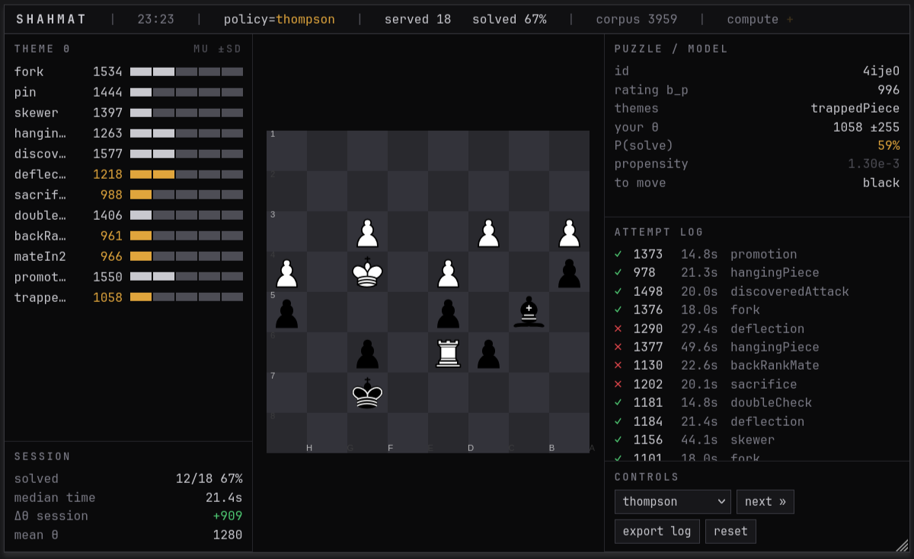

# SHAHMAT

Adaptive chess tactics trainer. A per-theme Bayesian skill model picks your next
puzzle with a bandit policy, entirely in the browser. No backend, no accounts,
works offline, free to host forever.



## How it works

- **Skill model** — one latent ability `θ_t ~ N(μ_t, σ_t²)` per tactical theme
  (~12 themes). Puzzle difficulty is the Lichess rating on the same scale. Solve
  probability is a 1-parameter IRT (Rasch) logit: `P = σ((μ − b)/173.7)`. After
  each attempt the posterior is moment-matched to a Gaussian (assumed-density
  filtering) — closed-form-ish, microseconds. `web/src/skill.ts`.
- **Selection policies** — `random`, `rating_match` (the honest baseline every
  trainer uses), `max_info` (maximise Fisher information ⇒ target `b ≈ μ`), and
  `thompson` (posterior sampling, explores uncertain themes). Every serve mixes
  in an ε-greedy floor and **logs its propensity** `P(puzzle | state)` — without
  that column off-policy evaluation is impossible later. `web/src/policy.ts`.
- **Corpus** — a ~4k-puzzle subset of the Lichess puzzle DB, balanced across
  themes × rating bands, bundled as 640 KB of JSON. Extraction script:
  `scripts/extract_subset.mjs`.

## Run locally

```bash
cd web
npm install
npm run dev      # http://localhost:5173
```

Rebuild the puzzle bundle (needs `data/lichess_db_puzzle.csv` from the
[Lichess database](https://database.lichess.org/#puzzles)):

```bash
node scripts/extract_subset.mjs 55   # ~4s, writes web/public/puzzles.json
```

## Deploy (free)

Static output in `web/dist`. Any of:

- **GitHub Pages** — the included workflow (`.github/workflows/deploy.yml`)
  builds and deploys on push to `main`. Enable Pages → Source: GitHub Actions.
- **Cloudflare Pages / Vercel** — root `web`, build `npm run build`, output `dist`.

## Known limitations (MVP)

- No engine analysis yet — that's Part B.

## Stack

Vanilla TS + Vite · [Chessground](https://github.com/lichess-org/chessground) ·
[chess.js](https://github.com/jhlywa/chess.js). No framework: the UI is a handful
of panels driven by one state object. Chessground is GPL-3.0, so this repo is GPL-3.0.
